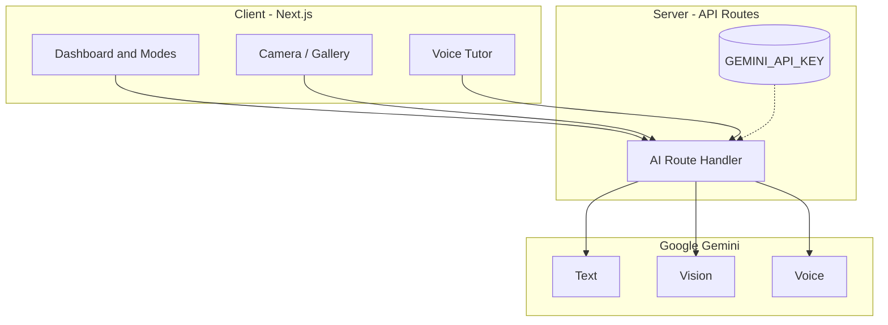

# 🏗 Architecture

LearnSphere AI is a **document-grounded** study platform built with **Next.js** and **Google Gemini**.

## Principles
| Principle | Meaning |
|---|---|
| Grounded | Answers come from the student's own document. |
| Honest | No sample questions or invented progress stats. |
| Engaging | Quests and practice turn studying into a game. |
| Multimodal | Text, images and voice. |
| Secure | Secrets stay on the server. |

## Deployment
Hosted on **Vercel**. See [deployment.md](deployment.md).
