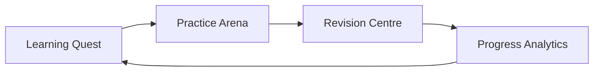

# 🎮 Gamified Learning Design

Goal: make studying feel like playing a game, while staying honest and educational.

## Loop

## Building blocks
| Element | Role |
|---|---|
| **Learning Quests** | Turn chapters and goals into missions. |
| **Practice Arena** | Self-test with questions made from your own notes. |
| **Revision Centre** | Quick wins before the exam. |
| **Progress Analytics** | Real activity only. |

## Planned enhancements (see roadmap)
- Study streaks, XP and badges
- Friend challenges and leaderboards

## Principles
1. **Fun, not fake** – rewards reflect real study activity.
2. **Learning first** – game elements support understanding.
3. **Personal** – everything is based on the student's own material.
