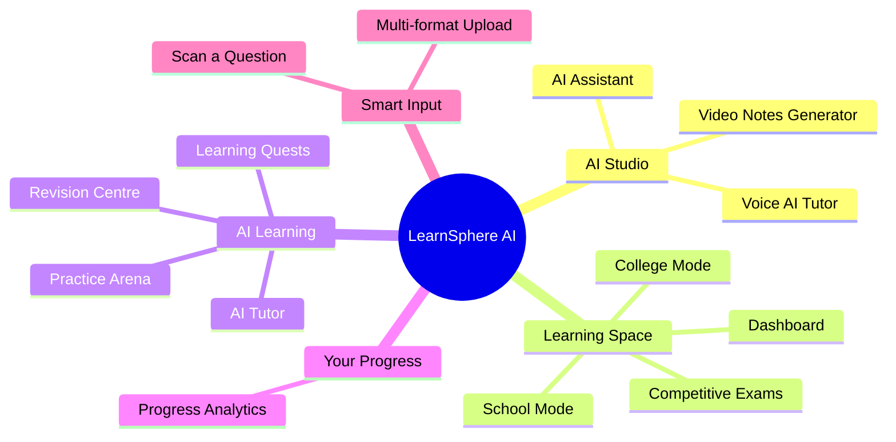
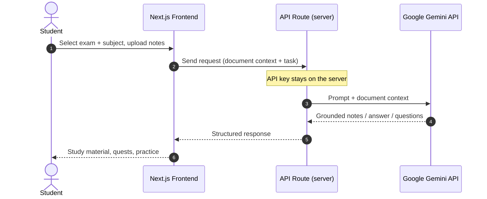
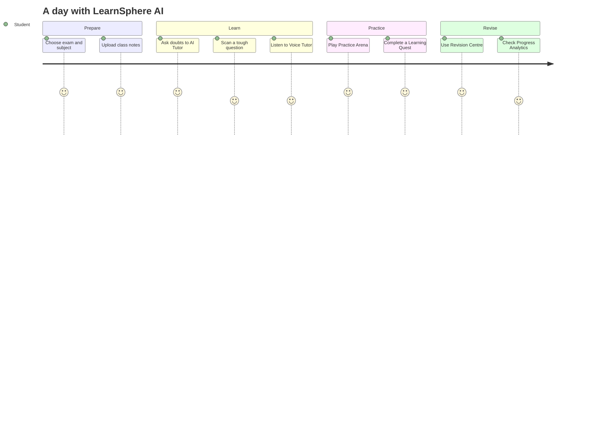
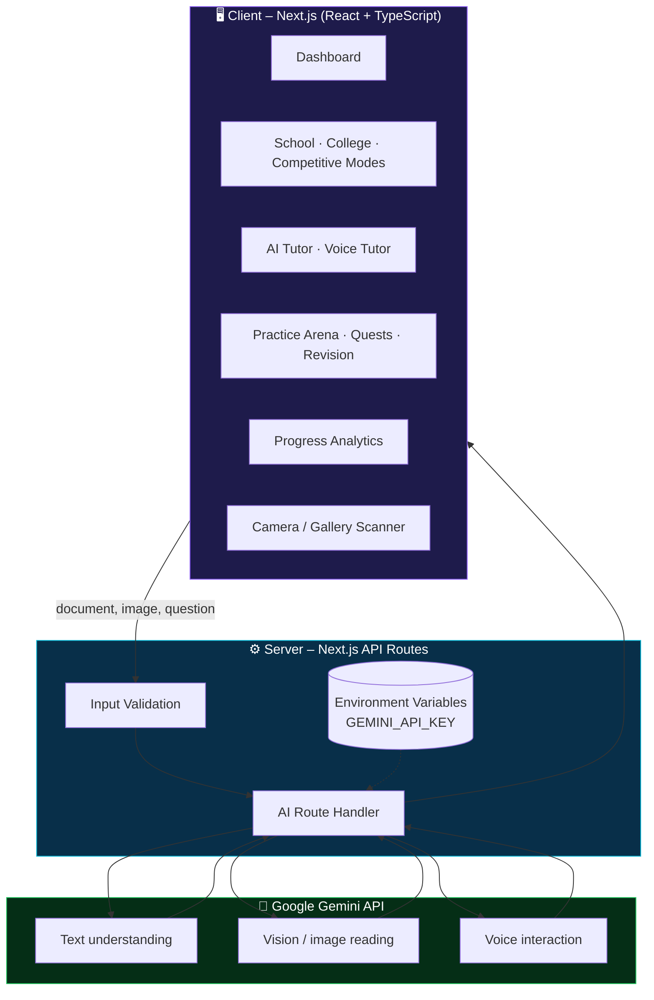
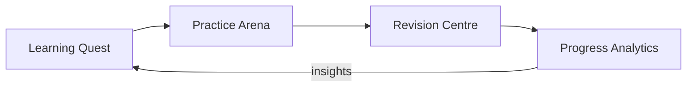
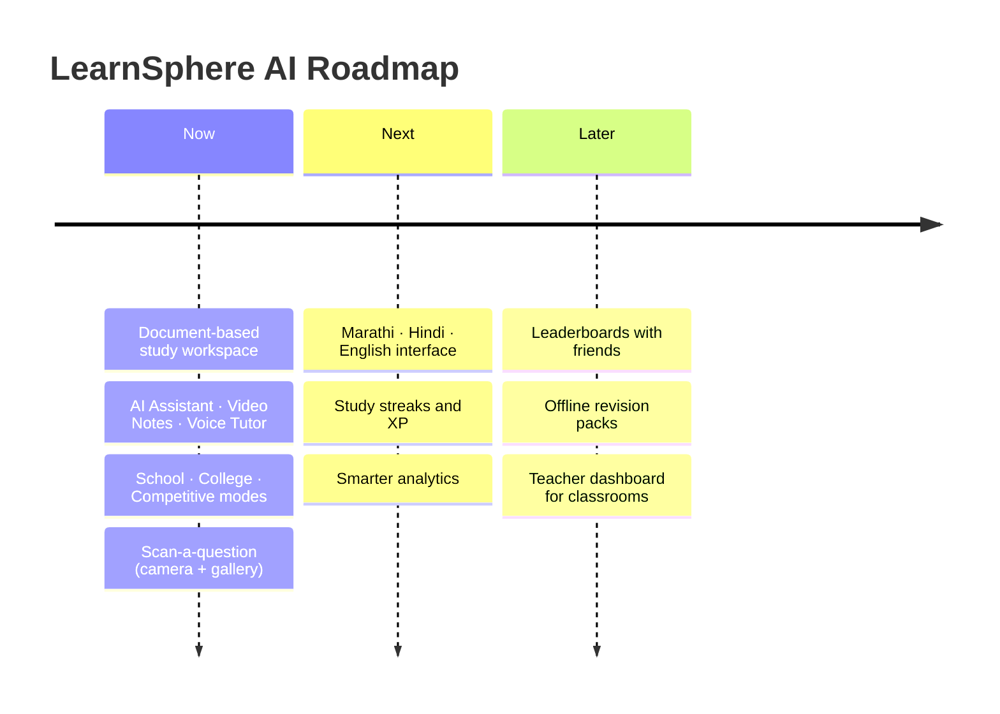

<div align="center">


<br>

<a href="https://learnsphere-ai-seven.vercel.app"></a>


### **A document-based AI study workspace that turns your own notes into a personalised, game-like exam preparation experience.**

[**🚀 Live Demo**](https://learnsphere-ai-seven.vercel.app) •
[**✨ Features**](#-features) •
[**🏗 Architecture**](#-architecture) •
[**🎬 Demo Script**](docs/DEMO-SCRIPT.md) •
[**🗺 Roadmap**](docs/ROADMAP.md) •
[**❓ FAQ**](docs/FAQ.md)

</div>

---

## ⚡ 30-Second Overview (for Judges)

| | |
|---|---|
| **🎯 Problem** | Students prepare with generic content that does not match *their* syllabus, notes or university pattern. |
| **💡 Solution** | Upload your **own** study material → Gemini generates notes, answers, questions and revision **from that document only**. |
| **👩‍🎓 Who it is for** | School students, college students (e.g. SPPU) and competitive-exam aspirants. |
| **🧠 What makes it different** | **Grounded in your document** – no sample questions, no invented progress stats. |
| **🎮 Experience** | Study like a game: quests, practice arena, smart revision. |
| **🗣 Multimodal** | Text, voice tutor, live-camera question scanning, 11 upload formats. |
| **🛠 Built with** | Next.js · TypeScript · Google Gemini API · Vercel |
| **🔗 Try it** | https://learnsphere-ai-seven.vercel.app |

<div align="center">

<br><sub><i>The LearnSphere AI dashboard – exam setup, document upload and AI question scanner.</i></sub>
</div>

---

## 📑 Table of Contents

1. [The Problem](#-the-problem)
2. [Our Solution](#-our-solution)
3. [Why LearnSphere AI Is Different](#-why-learnsphere-ai-is-different)
4. [Features](#-features)
5. [How It Works](#-how-it-works)
6. [Architecture](#-architecture)
7. [AI Approach](#-ai-approach)
8. [Gamified Learning](#-gamified-learning)
9. [Responsible AI, Privacy & Security](#-responsible-ai-privacy--security)
10. [Tech Stack](#-tech-stack)
11. [Getting Started](#-getting-started)
12. [Deploy on Vercel](#-deploy-on-vercel)
13. [Project Structure](#-project-structure)
14. [Impact](#-impact)
15. [Roadmap](#-roadmap)
16. [Documentation Index](#-documentation-index)
17. [Contributing](#-contributing) · [Team](#-team) · [License](#-license)

---

## ❗ The Problem

Students today prepare for exams using content that has nothing to do with *their* syllabus:

| Pain point | What happens today |
|---|---|
| 📚 **Generic content** | Question banks don't follow the university pattern or the teacher's notes. |
| 🤖 **Ungrounded chatbots** | General chatbots answer from the open internet, not from the student's own material. |
| 😴 **Boring study** | Low engagement → inconsistent revision → poor retention. |
| 📉 **Fake progress** | Many dashboards display made-up numbers instead of real preparation data. |
| 🧩 **Scattered tools** | Notes in one place, doubts in another, practice in a third. |

## 💡 Our Solution

**LearnSphere AI** is a single workspace where a student:

1. Picks the **real exam** (e.g. *SPPU*) and the **subject or chapter** (e.g. *Data Structures*).
2. **Uploads their own notes, syllabus or previous-year paper.**
3. Lets **Google Gemini** generate study material **from that document only**.
4. Learns through a **game-like** experience and tracks **real** progress.

> 🔒 **Grounded by design:** *No sample questions. No invented progress stats. Everything the student sees comes from what they uploaded.*

---

## 🥇 Why LearnSphere AI Is Different

| Capability | Typical study apps | Generic AI chatbots | **LearnSphere AI** |
|---|:---:|:---:|:---:|
| Works on **your own notes / syllabus** | ❌ | ⚠️ copy-paste only | ✅ |
| Exam + subject aware (e.g. SPPU – DS) | ⚠️ limited | ❌ | ✅ |
| Gamified learning (quests, arena) | ⚠️ some | ❌ | ✅ |
| Voice AI tutor | ❌ | ⚠️ some | ✅ |
| Scan a handwritten / printed question | ⚠️ some | ⚠️ some | ✅ |
| Multi-format upload (PDF, DOCX, PPT, XLS, images…) | ❌ | ⚠️ limited | ✅ |
| Honest progress (no fake stats) | ❌ | ❌ | ✅ |
| One workspace for School, College & Competitive | ❌ | ❌ | ✅ |

<sub>Comparison is a general, qualitative view of common product categories, not a claim about any specific product.</sub>

---

## ✨ Features



### 🤖 AI Studio
| Feature | What it does |
|---|---|
| **AI Assistant** | Ask doubts and get answers grounded in your uploaded document. |
| **Video Notes Generator** | Turns study content into concise, revisable video-style notes. |
| **Voice AI Tutor** | Talk to your tutor hands-free and learn through conversation. |

### 🎓 Learning Space
| Mode | Built for |
|---|---|
| **Dashboard** | Exam setup, document upload and quick actions in one place. |
| **School Mode** | Board-style learning for school students. |
| **College Mode** | University syllabus preparation (e.g. SPPU). |
| **Competitive Exams** | Focused preparation for entrance and competitive tests. |

### 🎮 AI Learning
| Feature | What it does |
|---|---|
| **AI Tutor** | Step-by-step, personalised explanations. |
| **Learning Quests** | Study goals turned into missions. |
| **Practice Arena** | Self-testing with questions generated from *your* material. |
| **Revision Centre** | Smart last-minute revision before exams. |

### 📊 Your Progress
| Feature | What it does |
|---|---|
| **Progress Analytics** | Shows real activity only – never fabricated numbers. |

### 📸 Scan a Question with AI
Take a photo of a printed or handwritten question using the **live camera**, or pick an image from the **gallery**, and let AI solve and explain it.

### 📄 Upload Almost Anything
`PDF` · `DOC` · `DOCX` · `PPT` · `PPTX` · `TXT` · `CSV` · `XLS` · `XLSX` · `JPG` · `PNG` — up to **50 MB**.

➡ Full details: [FEATURES.md](FEATURES.md) · [ai-features.md](ai-features.md)

---

## 🔄 How It Works

```mermaid
flowchart LR
    A["1️⃣ Set up exam<br/>Exam + Subject"] --> B["2️⃣ Upload notes<br/>PDF / DOCX / PPT / Image"]
    B --> C["3️⃣ Gemini reads<br/>your document"]
    C --> D["4️⃣ Generate material<br/>Notes · Answers · Questions"]
    D --> E["5️⃣ Learn like a game<br/>Quests · Practice Arena"]
    E --> F["6️⃣ Revise smartly<br/>Revision Centre"]
    F --> G["7️⃣ Track real progress<br/>Analytics"]
    style A fill:#312e81,stroke:#8b5cf6,color:#fff
    style B fill:#312e81,stroke:#8b5cf6,color:#fff
    style C fill:#1e3a8a,stroke:#06b6d4,color:#fff
    style D fill:#1e3a8a,stroke:#06b6d4,color:#fff
    style E fill:#7c2d12,stroke:#f59e0b,color:#fff
    style F fill:#7c2d12,stroke:#f59e0b,color:#fff
    style G fill:#14532d,stroke:#22c55e,color:#fff
```



### Request lifecycle



### Student journey



---

## 🏗 Architecture



| Layer | Responsibility |
|---|---|
| **Client** | Dark, responsive UI; upload, camera, quests, analytics. |
| **Server (API routes)** | Validates input, calls Gemini, keeps secrets off the browser. |
| **Gemini** | Understands documents/images and generates grounded output. |

➡ Deep dive: [ARCHITECTURE.md](ARCHITECTURE.md) · [solution-architecture.md](solution-architecture.md) · [system-workflow.md](system-workflow.md)

---

## 🧠 AI Approach

| Principle | How we apply it |
|---|---|
| **Grounding** | The student's uploaded document is the source of truth for every answer and question. |
| **Context-aware** | Exam name and subject/chapter shape the prompt (e.g. *SPPU – DS*). |
| **Multimodal** | Text, images (scan-a-question) and voice flow through one AI layer. |
| **Explain, don't just answer** | The tutor gives step-by-step reasoning to support real learning. |
| **Honesty first** | No fabricated questions, scores or progress. |

---

## 🎮 Gamified Learning

Studying should feel like progress in a game, not a chore.



➡ Design details: [docs/GAMIFICATION.md](docs/GAMIFICATION.md)

---

## 🛡 Responsible AI, Privacy & Security

- 🔑 **API keys live on the server** in environment variables – never in the browser or the repo.
- 🚫 `.env*` files are excluded via `.gitignore`.
- 📄 Uploaded study material is used only to generate the student's own study content.
- ✅ Inputs are validated (file type and size limits).
- 🧭 AI output is a **study aid** – students should verify important facts with their textbooks/teachers.

➡ Full policy: [security.md](security.md)

---

## 🛠 Tech Stack

| Layer | Technology |
|---|---|
| **Framework** | Next.js (App Router) |
| **Language** | TypeScript |
| **UI** | React, custom dark theme (`globals.css`) |
| **AI** | Google Gemini API (text, vision, voice) |
| **Hosting** | Vercel |
| **Version control** | Git & GitHub |

---

## 🚀 Getting Started

### Prerequisites
- [Node.js](https://nodejs.org) 18 or newer
- A free Gemini API key → https://aistudio.google.com/app/apikey

### Run locally

```bash
# 1. Get the code
git clone https://github.com/amrut4469-blip/LearnSphere-AI.git
cd LearnSphere-AI

# 2. Install dependencies
npm install

# 3. Add your API key
cp .env.example .env.local
#    open .env.local and paste your Gemini API key

# 4. Start the development server
npm run dev
```

Open **http://localhost:3000** 🎉

### Environment variables

| Variable | Description |
|---|---|
| `GEMINI_API_KEY` | Your Google Gemini API key (server-side only). |

---

## ☁ Deploy on Vercel

1. Push this repository to GitHub.
2. Import it in [Vercel](https://vercel.com/new).
3. Add `GEMINI_API_KEY` under **Settings → Environment Variables**.
4. Click **Deploy**.

➡ Details: [deployment.md](deployment.md)

---

## 📁 Project Structure

```
LearnSphere-AI/
├── app/                        # Next.js pages, layout and API routes
├── assets/                     # Banner and screenshots
├── docs/                       # Extra documentation
│   ├── DEMO-SCRIPT.md          # 3-minute demo walkthrough
│   ├── FAQ.md
│   ├── GAMIFICATION.md
│   └── ROADMAP.md
├── .github/                    # Issue templates
├── ARCHITECTURE.md
├── FEATURES.md
├── ai-features.md
├── problem-statement.md
├── solution-architecture.md
├── system-workflow.md
├── security.md
├── deployment.md
├── CONTRIBUTING.md
├── CODE_OF_CONDUCT.md
├── LICENSE
├── package.json
└── README.md
```

---

## 🌍 Impact

- 🎯 **UN SDG 4 – Quality Education:** personalised, accessible preparation for every learner.
- 🇮🇳 **Built for Indian exam patterns:** universities (e.g. SPPU), school boards and competitive exams.
- 💸 **Lower barrier:** replaces scattered paid resources with one AI workspace that uses the student's own material.
- 🧑‍🏫 **Teacher-friendly vision:** the same document-grounded approach can support classrooms (see roadmap).

---

## 🗺 Roadmap



- [x] Document-based study workspace
- [x] AI Assistant, Video Notes Generator, Voice AI Tutor
- [x] School / College / Competitive modes
- [x] Scan-a-question with live camera & gallery
- [x] Learning Quests, Practice Arena, Revision Centre
- [ ] Multi-language support (Marathi, Hindi, English)
- [ ] Streaks, XP and badges
- [ ] Leaderboards & friend challenges
- [ ] Offline revision packs
- [ ] Teacher dashboard

➡ More: [docs/ROADMAP.md](docs/ROADMAP.md)

---

## 📚 Documentation Index

| Document | Description |
|---|---|
| [problem-statement.md](problem-statement.md) | The problem we are solving |
| [solution-architecture.md](solution-architecture.md) | How the solution is designed |
| [system-workflow.md](system-workflow.md) | End-to-end workflow |
| [ARCHITECTURE.md](ARCHITECTURE.md) | Technical architecture |
| [FEATURES.md](FEATURES.md) | Feature guide |
| [ai-features.md](ai-features.md) | AI capabilities |
| [security.md](security.md) | Security & privacy |
| [deployment.md](deployment.md) | Deployment guide |
| [docs/DEMO-SCRIPT.md](docs/DEMO-SCRIPT.md) | 3-minute demo script |
| [docs/GAMIFICATION.md](docs/GAMIFICATION.md) | Game-like learning design |
| [docs/FAQ.md](docs/FAQ.md) | Frequently asked questions |
| [docs/ROADMAP.md](docs/ROADMAP.md) | Future plans |

---

## 🤝 Contributing

Contributions are welcome! Read [CONTRIBUTING.md](CONTRIBUTING.md) and our [Code of Conduct](CODE_OF_CONDUCT.md), then open an issue or pull request.

## 👥 Team

| Name | Role |
|---|---|
| [@amrut4469-blip](https://github.com/amrut4469-blip) | Developer |

## 📄 License

Released under the [MIT License](LICENSE).

<div align="center">

### ⭐ If LearnSphere AI helps you, please star the repo!

<sub>Made with ❤️ in India for students who want to study smarter, not harder.</sub>

</div>
