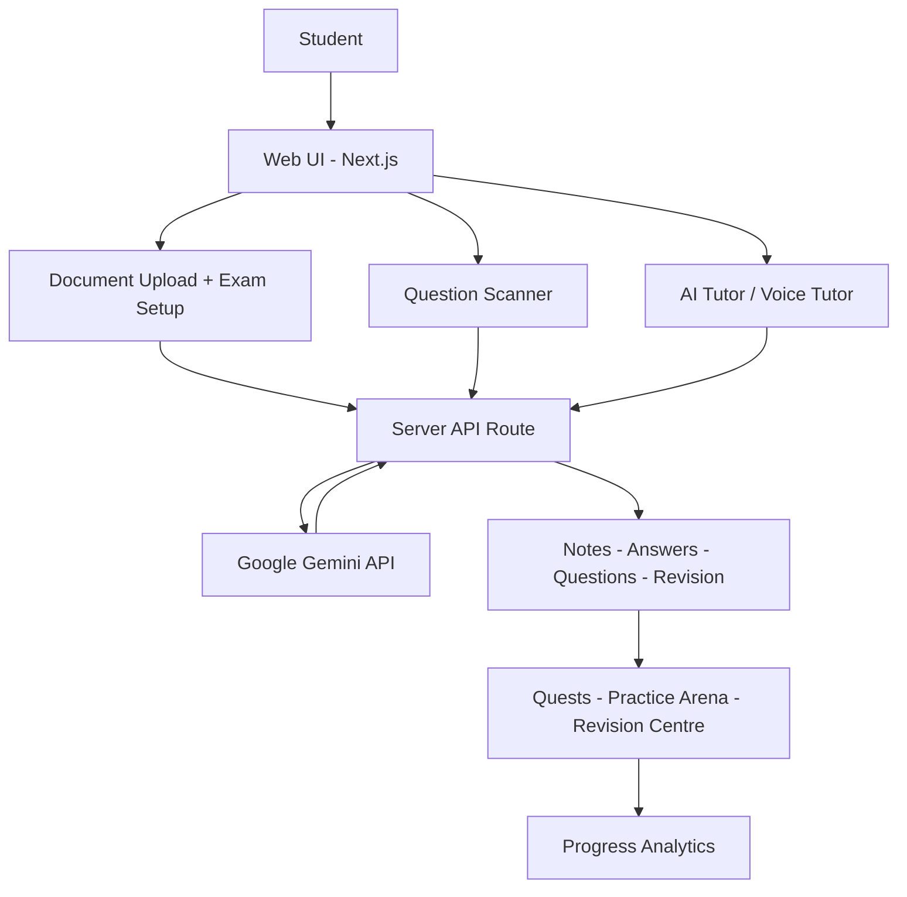

# 🧩 Solution Architecture

## Idea
**LearnSphere AI** converts a student's own document into personalised study experiences using Google Gemini.

## Components

## Design decisions
| Decision | Reason |
|---|---|
| Document-grounded generation | Keeps content relevant to the student's syllabus. |
| Server-side API route | Protects the Gemini API key. |
| Multimodal input (text, image, voice) | Students ask doubts in different ways. |
| Gamified layer | Improves engagement and consistency. |
| Honest analytics | Builds trust; no invented stats. |
| Vercel hosting | Fast deployment and easy sharing. |
