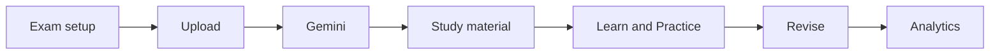

# 🔁 System Workflow

## 1. Exam setup
The student enters the **exam name** (e.g. SPPU) and the **subject or chapter** (e.g. DS).

## 2. Upload study material
Supported formats: PDF, DOC, DOCX, PPT, PPTX, TXT, CSV, XLS, XLSX, JPG, PNG (max 50 MB).

## 3. AI processing
The document context, exam and subject are sent to Gemini through a server-side route.

## 4. Study material generation
Gemini returns notes, answers, practice questions and revision content based on the uploaded document.

## 5. Learning
The student learns through AI Tutor, Voice AI Tutor, Learning Quests and Practice Arena.

## 6. Scan a question (optional)
The student takes a photo with the live camera or chooses an image from the gallery. AI reads and explains the question.

## 7. Revision & progress
The Revision Centre helps with last-minute prep; Progress Analytics shows real activity.

